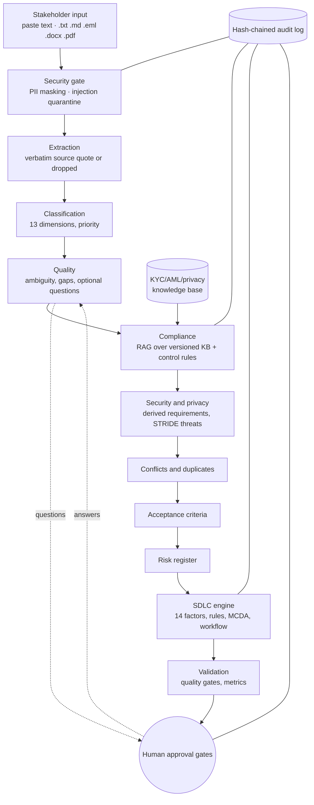

# KYCompass

**Agentic requirements engineering for KYC and customer onboarding.** Give it vague stakeholder
notes (an interview, an email thread, meeting minutes, a policy document) and it extracts the
requirements, checks them against KYC / AML / data-protection rules, scores the risks, asks you the
questions that matter (you choose which to answer), and recommends a justified SDLC with a
project-specific workflow. Every critical decision goes through a human approval gate and every
action lands in a hash-chained audit trail.

Built for the course problem statement *"Agentic AI for automated requirement gathering, analysis
and SDLC identification in the financial sector"*, scoped to one sector: customer onboarding and KYC.

> Advisory output. Regulatory mappings are proposals for a compliance officer, never legal
> determinations. The knowledge base holds **paraphrased** summaries for prototyping: verify them
> against the official texts before relying on them.

## Quick start

```bash
python3.11 -m venv .venv && . .venv/bin/activate
pip install -r requirements.txt
cp .env.example .env            # then put your GOOGLE_API_KEY in it

.venv/bin/uvicorn src.api.main:app --port 8000
# open http://localhost:8000
pytest -q                       # 64 tests, fully offline (no API key needed)
```

On the start page open an analysed demo instantly (no API key or waiting), paste some notes (or click **Fill in an example**), or try one of the three
ready-made samples in `data/samples/`:

| Sample | Situation | What the SDLC engine recommends |
|---|---|---|
| Digital savings account onboarding (early idea) | Vague, undecided, hedging stakeholders | **Spiral** (about 87%) |
| Periodic KYC refresh programme | Firm, signed-off, regulator-driven | **Waterfall** (plan-driven) |
| EU merchant onboarding (KYB) | Heavy regulation *and* fast-moving product team | **Agile-V hybrid** (regulated hybrid) |

Demos are rebuilt with `python -m src.demos build --all` (uses the live model). A full analysis takes about 12 model calls (1 to 3 minutes). Calls are paced to stay inside Gemini's
free tier (15 requests/minute) and finished stages are saved, so a quota error never loses work:
click **Resume analysis**.

## How it works



The coordinator (`src/pipeline/runner.py`) runs this in a fixed order. **The model never decides
control flow.** Each stage records which requirements it has processed, so a re-run (new input,
answered questions, an edit, or a retry after a quota error) does only the outstanding work.

### The question flow (your choice)

Weak requirements get questions a business analyst would ask, with one-click suggested answers.
Answering is optional:

* **Answer** a question, then **Apply answers and re-analyse**. The answers are folded into the
  requirement, which is then re-checked, re-mapped, re-scored, and its acceptance criteria rewritten.
* **Skip** a question. It stays as an open issue in the SRS and does not block the baseline.
* You can reopen a skipped question or change an answer until it has been applied.

### SDLC selection

Scores are deterministic and explainable; the language model only writes the narrative.

1. **14 decision factors** (requirement stability, regulatory criticality, security risk, complexity,
   size, legacy dependence, change frequency, continuous-delivery need, stakeholder availability,
   documentation demand, schedule pressure, verification need, failure consequence, technical
   uncertainty), each scored 1 to 5 **with its evidence**.
2. **Hard rules**, for example unstable requirements plus high uncertainty promote Spiral, and heavy
   regulation plus frequent change promotes the regulated hybrids.
3. **Weighted multi-criteria fit** against seven models (Waterfall, V-Model, Spiral, Agile,
   DevSecOps, Agile-V hybrid, Agile-DevSecOps hybrid), reported as ranked suitability percentages.
4. A **project-specific workflow** (phases, activities, roles, deliverables, security activities,
   testing, compliance checkpoints, entry/exit criteria, approval gates), customised with this
   project's open questions, conflicts and control gaps.

## Mapping to the problem statement

| Item | Implementation |
|---|---|
| Scope and outputs | KYC onboarding. SRS (.docx and .md), user stories, use cases, acceptance criteria, compliance matrix, control coverage, risk register, traceability matrix, SDLC workflow, assumptions/dependencies/open issues, requirements status report |
| Inputs | Pasted text, `.txt .md .eml .docx .pdf`; PII masked and injection text quarantined before anything is stored or analysed (`src/security`) |
| Multi-agent architecture | 10 agents plus coordinator in `src/agents`, orchestrated by `src/pipeline/runner.py` with shared state and approval gates |
| Knowledge base | 50 versioned clauses (RBI KYC Master Direction, PMLA, DPDP, Aadhaar Act, FATF, EU AMLD/AMLR, GDPR, FinCEN CIP/CDD/SAR, OFAC, GLBA, NIST 800-63A, ISO 30107, OWASP ASVS, ISO 27001, sample internal policies) and 21 mandatory controls; each item has source, jurisdiction, effective date, version, applicability |
| Retrieval-grounded generation | Chroma semantic retrieval with jurisdiction filtering (lexical fallback). The model may only cite clauses retrieved for that requirement; others are dropped and counted. Citations carry confidence; high-impact or low-confidence mappings are flagged for legal review |
| Requirement structure | id, statement, 13-way multi-label category, source stakeholder, source quote, justification, priority, dependencies, assumptions, acceptance criteria, regulations, risk, confidence, approval status, history |
| Quality analysis | Ambiguity, incompleteness, untestability, non-atomic, undefined term, infeasible, missing source; duplicates and contradictions; failures become optional clarification questions |
| Compliance and security | Regulation mapping, mandatory-control coverage (covered / partial / gap), derived requirements for gaps, implicit security/privacy requirements, STRIDE threat model |
| SDLC engine and workflow | See above |
| Human-in-the-loop | Per-requirement approve / send back / reject / edit; four gates (baseline, regulatory interpretations, conflict resolutions, SDLC) with role-based sign-offs; sensitive requirements need a security, compliance or architect role |
| Platform security | PII masking, injection quarantine, untrusted-document delimiting, retrieval limited to the KB, role checks, hash-chained audit log with tamper detection |
| Evaluation | In-app metrics only (completeness, traceability, control coverage, hallucinations dropped, confidence). **A gold-annotated evaluation harness is not built.** |

## Honest limitations

* **Authentication is a demo.** The client states a name and role. In production roles must come from
  the bank's identity provider (OIDC claims) and MFA, encryption at rest and retention policy belong
  to the deployment.
* **PII masking is regex-based.** It catches structured identifiers (PAN, Aadhaar, card numbers with
  Luhn check, SSN, IBAN, phone, email, DOB, passport numbers) but not free-text names or addresses.
* **The knowledge base is paraphrased and small** (50 clauses). Regulatory change needs an owner.
* **Language-model output varies.** Temperature is set low (0.2); conflicts persist across re-runs
  until a requirement they involve changes, but extraction and wording can still differ between runs.
* **SDLC factor weights are expert heuristics.** Calibrate them against architects' historical decisions.
* **No live interviews.** Interaction is "extract, then ask what is unclear", not a chat with a stakeholder.

## Layout

```
src/
  agents/       extraction, classification, quality, conflict_detection, compliance,
                security_privacy, acceptance_criteria, risk_analysis, refinement,
                documentation, sdlc (explanation), llm_client (rate limiter + retry)
  pipeline/     runner (coordinator), jobs (background progress), validation, approvals
  sdlc/         engine (factors, rules, MCDA), workflow (phase templates)
  knowledge_base/  kb.py + data/regulations.json, data/controls.json
  security/     pii, injection, gate
  ingest/       file to text
  artefacts/    SRS (.docx/.md), CSVs, markdown writers
  models/       requirement (contracts), db (SQLAlchemy), audit (hash chain)
  api/          FastAPI app
  web/          the website (plain HTML/CSS/JS, no build step)
data/samples/   three sample projects
tests/          64 offline tests (fake agents stand in for Gemini)
```

## Configuration

See `.env.example`. The model is `gemini-3.1-flash-lite` by default.
